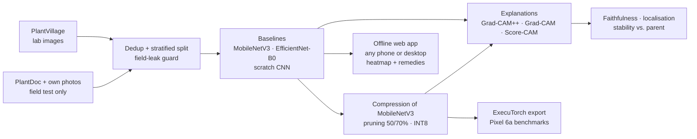

<div align="center">

# 🌿 crop-disease-xai

**Do compressed crop-disease models still explain themselves faithfully on a phone?**

Crop-leaf disease classification with **Grad-CAM++** explanations, a staged **compression** pipeline
(structured pruning → INT8 quantization), remedies for every class, and an **offline web app** that
diagnoses and explains on any phone or desktop, using a closed-form, gradient-free Grad-CAM++ that
runs in a single forward pass.


</div>

> **Picking up this project?** Start with [HANDOFF.md](HANDOFF.md): current state, rules, setup, next steps and the decision log.

---

## Contents
- [Overview](#overview)
- [Approach](#approach)
- [Results](#results)
- [Getting started](#getting-started)
- [Reproducibility](#reproducibility)
- [Repository layout](#repository-layout)
- [Project status & plan](#project-status--plan)
- [Datasets](#datasets)

## Overview

A farmer with a basic phone and patchy internet can't rely on a cloud model, and has no way to check
*why* an app says a leaf has late blight. Heatmap explanations can show the reasoning, but only if they
are **faithful**, and only if they survive the compression needed to run on cheap hardware.

This project measures that directly:

1. **Accuracy vs. size:** how much accuracy each compression stage costs (structured pruning at 50/70%, INT8 quantization, and both stacked).
2. **Explanation quality under compression:** whether Grad-CAM++ maps stay faithful and stable, and which compression stage changes them most.
3. **On-device cost:** whether Grad-CAM++ runs in real time on a mid-range Android phone (Pixel 6a).
4. **Lab → field gap:** models trained on clean lab images (PlantVillage) are evaluated on real field photos (PlantDoc), and the heatmaps show what the models rely on.

The study is deliberately **compute-lean**: it compresses one mobile model (MobileNetV3) and compares
it with EfficientNet-B0 and a from-scratch CNN, so everything runs on a free-tier GPU.

## Approach



### Gradient-free Grad-CAM++ on the device

Mobile runtimes only run forward passes, but Grad-CAM++ needs gradients. Every CNN here ends in
global average pooling followed by a single linear layer, so the gradient of class score $y_c$ with
respect to feature map $A^k$ (size $H \times W$) is a constant:

$$
g_k = \frac{\partial y_c}{\partial A^k_{ij}} = \frac{W_{ck}}{HW}
$$

Substituting into the Grad-CAM++ weights gives a closed form that needs only the feature maps and the classifier weights:

$$
\alpha_k = \frac{g_k^2}{2g_k^2 + g_k^3 \sum_{ij} A^k_{ij}}, \qquad
w_k = HW \cdot \mathrm{ReLU}(g_k)\,\alpha_k, \qquad
L_c = \mathrm{ReLU}\Big(\sum_k w_k A^k\Big)
$$

The exported model returns logits and the final feature maps, and the app computes the heatmap from
these in one pass. The implementation (`src/cropxai/explain/closed_form.py`) is tested to match
`pytorch-grad-cam` for every CNN in the study (`tests/test_explain.py`), so it is an exact
reformulation, not an approximation.

### Explanation metrics
- **Faithfulness:** deletion / insertion AUC, Average Drop, Increase in Confidence, ROAD (with a batched GPU implementation of ROAD's noisy linear imputation, tested against the reference implementation). Score-CAM, the most expensive method, is computed for the uncompressed models only.
- **Localisation:** pointing game and IoU against hand-drawn lesion masks.
- **Stability under compression:** Spearman rank correlation, SSIM and top-10% IoU against the uncompressed parent's heatmaps.

## Results

> **Status:** baseline experiments are running. Every table below is generated by
> `scripts/make_tables.py` from `results/metrics/**.json`; cells stay empty (—) until the
> corresponding runs are finished and committed. Values are mean ± sample std over 3 seeds;
> `(n=k)` marks an incomplete seed set.

### Table 1 — Accuracy & efficiency
Field "strict" = argmax over all 38 classes (what the app does); "restricted" = argmax over the
classes present in the field set. Weights = parameters × 4 bytes (float) or × 1 byte (INT8). Desktop
latency is not reported for INT8 models (they run reference ops on a desktop); phone latency is added
with the Android app.

<!-- table1:start -->
| Model | Params (M) | Weights (MB) | Top-1 PV test (%) | Macro-F1 PV test (%) | ECE PV test | Field top-1 strict (%) | Field top-1 restricted (%) | Desktop GPU latency (ms) | Desktop CPU latency (ms) |
|---|---|---|---|---|---|---|---|---|---|
| effnet_b0_fe | 4.06 ± 0.00 | 16.22 ± 0.00 | 96.11 ± 0.27 | 95.07 ± 0.36 | 0.035 ± 0.000 | 24.27 ± 0.81 | 26.99 ± 1.07 | 5.61 ± 0.03 | 15.1 ± 1.8 |
| mnv3_fe | 3.01 ± 0.00 | 12.03 ± 0.00 | 96.66 ± 0.07 | 95.87 ± 0.12 | 0.052 ± 0.001 | 21.77 ± 0.14 | 24.56 ± 0.20 | 4.44 ± 0.06 | 9.4 ± 0.6 |
| mnv3_fe_int8 | 3.01 ± 0.00 | 3.01 ± 0.00 | 94.12 ± 0.04 | 92.82 ± 0.11 | 0.074 ± 0.000 | 21.28 ± 0.30 | 23.67 ± 0.41 | — | — |
| mnv3_fe_p50 | 0.79 ± 0.00 | 3.17 ± 0.00 | 69.25 ± 0.34 | 53.83 ± 0.28 | 0.056 ± 0.002 | 6.42 ± 0.26 | 8.55 ± 0.46 | 4.55 ± 0.08 | 6.9 ± 0.9 |
| mnv3_fe_p50_ft8 | 0.79 ± 0.00 | 3.17 ± 0.00 | 88.87 ± 0.45 | 84.44 ± 0.43 | 0.013 ± 0.001 | 9.90 ± 0.34 | 13.16 ± 0.22 | 7.52 ± 4.81 | 10.6 ± 1.4 |
| mnv3_fe_p50_int8 | 0.79 ± 0.00 | 0.79 ± 0.00 | 61.05 ± 2.05 | 44.53 ± 2.08 | 0.059 ± 0.032 | 6.05 ± 0.61 | 9.01 ± 0.42 | — | — |
| mnv3_fe_p70 | 0.30 ± 0.00 | 1.21 ± 0.00 | 51.62 ± 0.63 | 29.80 ± 0.49 | 0.085 ± 0.001 | 4.06 ± 0.75 | 6.16 ± 0.13 | 4.52 ± 0.11 | 5.2 ± 0.2 |
| mnv3_fe_p70_ft8 | 0.30 ± 0.00 | 1.21 ± 0.00 | 77.82 ± 0.51 | 66.47 ± 1.32 | 0.044 ± 0.002 | 5.74 ± 0.25 | 7.77 ± 0.08 | 4.65 ± 0.36 | 8.1 ± 2.4 |
| mnv3_fe_p70_int8 | 0.30 ± 0.00 | 0.30 ± 0.00 | 46.54 ± 0.14 | 26.37 ± 0.27 | 0.158 ± 0.027 | 3.13 ± 0.17 | 5.00 ± 0.60 | — | — |
| mnv3_ft_field | 3.01 ± 0.00 | 12.03 ± 0.00 | 99.44 ± 0.03 | 99.16 ± 0.05 | 0.105 ± 0.003 | 23.43 ± 0.56 | 27.44 ± 0.00 | 4.44 ± 0.11 | 12.4 ± 3.2 |
| scratch_cnn | 1.18 (n=1) | 4.73 (n=1) | 99.76 (n=1) | 99.66 (n=1) | 0.003 (n=1) | 15.42 (n=1) | 17.41 (n=1) | 0.80 (n=1) | 12.1 (n=1) |
<!-- table1:end -->

### Table 2 — Explanation quality
The model's predicted class is explained on a fixed, seeded image sample (the same images for every
model). Pointing game and IoU need lesion masks, which exist only for the project's own field photos.

<!-- table2:start -->
| Model | Method | Del. AUC ↓ (test) | Ins. AUC ↑ (test) | Avg. Drop % ↓ (test) | Inc. Conf. % ↑ (test) | ROAD ↑ (test) | Del. AUC ↓ (field) | Ins. AUC ↑ (field) | Pointing ↑ (field) | IoU ↑ (field) |
|---|---|---|---|---|---|---|---|---|---|---|
| effnet_b0_fe | Grad-CAM++ | 0.533 ± 0.005 | 0.713 ± 0.008 | 43.0 ± 1.3 | 11.7 ± 0.9 | 0.108 ± 0.004 | 0.242 ± 0.013 | 0.418 ± 0.007 | — | — |
| effnet_b0_fe | Grad-CAM | 0.479 ± 0.005 | 0.749 ± 0.007 | 26.9 ± 1.2 | 24.9 ± 1.2 | 0.151 ± 0.004 | 0.176 ± 0.005 | 0.494 ± 0.018 | — | — |
| effnet_b0_fe | Score-CAM | 0.544 ± 0.015 | 0.704 ± 0.016 | 57.8 ± 4.2 | 5.3 ± 2.3 | 0.114 ± 0.012 | 0.207 ± 0.005 | 0.455 ± 0.012 | — | — |
| mnv3_fe | Grad-CAM++ | 0.476 ± 0.002 | 0.733 ± 0.002 | 37.0 ± 0.2 | 12.8 ± 0.2 | 0.117 ± 0.001 | 0.226 ± 0.001 | 0.474 ± 0.001 | — | — |
| mnv3_fe | Grad-CAM | 0.431 ± 0.001 | 0.754 ± 0.003 | 36.9 ± 0.2 | 21.3 ± 0.6 | 0.144 ± 0.003 | 0.183 ± 0.002 | 0.534 ± 0.003 | — | — |
| mnv3_fe | Score-CAM | 0.496 ± 0.005 | 0.686 ± 0.003 | 48.8 ± 0.1 | 12.0 ± 0.0 | 0.085 ± 0.002 | 0.217 ± 0.002 | 0.498 ± 0.006 | — | — |
| mnv3_fe_int8 | Grad-CAM++ (closed form) | 0.376 ± 0.001 | 0.629 ± 0.002 | 55.0 ± 0.2 | 10.6 ± 0.5 | 0.111 ± 0.002 | 0.233 ± 0.003 | 0.468 ± 0.005 | — | — |
| mnv3_fe_p50 | Grad-CAM++ | 0.131 ± 0.005 | 0.261 ± 0.008 | 85.8 ± 2.1 | 5.2 ± 1.2 | 0.095 ± 0.004 | 0.115 ± 0.005 | 0.252 ± 0.012 | — | — |
| mnv3_fe_p50_ft8 | Grad-CAM++ | 0.203 ± 0.007 | 0.421 ± 0.017 | 84.4 ± 2.9 | 2.7 ± 0.9 | 0.144 ± 0.003 | 0.162 ± 0.014 | 0.379 ± 0.012 | — | — |
| mnv3_fe_p50_int8 | Grad-CAM++ (closed form) | 0.115 ± 0.004 | 0.276 ± 0.002 | 84.8 ± 1.4 | 7.6 ± 1.6 | 0.105 ± 0.004 | 0.106 ± 0.014 | 0.297 ± 0.023 | — | — |
| mnv3_fe_p70 | Grad-CAM++ | 0.104 ± 0.003 | 0.304 ± 0.005 | 94.0 ± 2.1 | 1.4 ± 0.2 | 0.084 ± 0.003 | 0.082 ± 0.011 | 0.243 ± 0.033 | — | — |
| mnv3_fe_p70_ft8 | Grad-CAM++ | 0.130 ± 0.008 | 0.470 ± 0.006 | 90.7 ± 4.0 | 3.0 ± 0.7 | 0.119 ± 0.007 | 0.131 ± 0.013 | 0.321 ± 0.048 | — | — |
| mnv3_fe_p70_int8 | Grad-CAM++ (closed form) | 0.106 ± 0.035 | 0.228 ± 0.010 | 84.7 ± 1.6 | 6.0 ± 2.2 | 0.063 ± 0.011 | 0.083 ± 0.010 | 0.222 ± 0.044 | — | — |
| mnv3_ft_field | Grad-CAM++ | 0.345 ± 0.012 | 0.818 ± 0.005 | 29.3 ± 1.4 | 16.6 ± 2.6 | 0.201 ± 0.002 | 0.127 ± 0.007 | 0.423 ± 0.007 | — | — |
| mnv3_ft_field | Grad-CAM | 0.341 ± 0.012 | 0.824 ± 0.006 | 29.4 ± 2.0 | 16.4 ± 2.8 | 0.212 ± 0.001 | 0.107 ± 0.006 | 0.486 ± 0.012 | — | — |
| mnv3_ft_field | Score-CAM | 0.370 ± 0.009 | 0.817 ± 0.012 | 48.5 ± 0.8 | 8.7 ± 1.2 | 0.195 ± 0.010 | 0.149 ± 0.014 | 0.439 ± 0.005 | — | — |
| scratch_cnn | Grad-CAM++ | 0.289 (n=1) | 0.909 (n=1) | 34.8 (n=1) | 4.7 (n=1) | 0.238 (n=1) | 0.191 (n=1) | 0.631 (n=1) | — | — |
| scratch_cnn | Grad-CAM | 0.280 (n=1) | 0.910 (n=1) | 43.9 (n=1) | 4.7 (n=1) | 0.229 (n=1) | 0.177 (n=1) | 0.643 (n=1) | — | — |
| scratch_cnn | Score-CAM | 0.289 (n=1) | 0.896 (n=1) | 29.0 (n=1) | 2.0 (n=1) | 0.189 (n=1) | 0.230 (n=1) | 0.591 (n=1) | — | — |
<!-- table2:end -->

### Table 3 — Stability under compression (vs. uncompressed parent)
Closed-form Grad-CAM++ maps of each compressed variant compared with the uncompressed parent's, for
the class the parent predicts, on the same images.

<!-- table3:start -->
| Variant | Spearman ↑ (test) | SSIM ↑ (test) | Top-10% IoU ↑ (test) | Spearman ↑ (field) | SSIM ↑ (field) | Top-10% IoU ↑ (field) |
|---|---|---|---|---|---|---|
| mnv3_fe_int8 | 0.919 ± 0.000 | 0.903 ± 0.000 | 0.638 ± 0.001 | 0.927 ± 0.001 | 0.899 ± 0.001 | 0.672 ± 0.003 |
| mnv3_fe_p50 | 0.368 ± 0.005 | 0.529 ± 0.003 | 0.125 ± 0.003 | 0.137 ± 0.007 | 0.471 ± 0.006 | 0.111 ± 0.007 |
| mnv3_fe_p50_ft8 | 0.462 ± 0.009 | 0.544 ± 0.006 | 0.151 ± 0.005 | 0.308 ± 0.007 | 0.524 ± 0.002 | 0.154 ± 0.002 |
| mnv3_fe_p50_int8 | 0.370 ± 0.012 | 0.530 ± 0.007 | 0.129 ± 0.005 | 0.251 ± 0.016 | 0.502 ± 0.005 | 0.131 ± 0.004 |
| mnv3_fe_p70 | 0.240 ± 0.008 | 0.436 ± 0.004 | 0.109 ± 0.002 | 0.002 ± 0.017 | 0.410 ± 0.006 | 0.062 ± 0.003 |
| mnv3_fe_p70_ft8 | 0.398 ± 0.015 | 0.477 ± 0.005 | 0.152 ± 0.005 | 0.133 ± 0.002 | 0.463 ± 0.005 | 0.114 ± 0.003 |
| mnv3_fe_p70_int8 | 0.209 ± 0.014 | 0.407 ± 0.009 | 0.103 ± 0.003 | -0.021 ± 0.009 | 0.395 ± 0.008 | 0.057 ± 0.005 |
<!-- table3:end -->

### Table 4 — On-device (Pixel 6a)
| Variant | Disk (MB) | Cold start | Latency median | Latency p95 | Heatmap latency | Peak memory | Battery / N inf. |
|---|---|---|---|---|---|---|---|
| — | — | — | — | — | — | — | — |

## Getting started

### Install (local: tests and data tooling)
```bash
git clone https://github.com/ranjanvrma/crop-disease-xai.git
cd crop-disease-xai
python -m venv .venv
.venv/Scripts/python -m pip install -e ".[train,dev]"   # on Linux/macOS: .venv/bin/python
.venv/Scripts/python -m pytest
```
The unit tests use small synthetic images, so they run without the datasets.

### Data
Download PlantVillage (colour) and PlantDoc and lay them out as described in
[`data/README.md`](data/README.md). The train / val / test / field-test split is already pinned in
[`splits/`](splits/), so everyone uses the same split.

### Offline web app
[`web/`](web/) is an installable app (PWA) for any phone or desktop browser: photo → diagnosis or
"not sure" → Grad-CAM++ heatmap computed on the device → a live check that the heatmap is faithful →
an exact breakdown of the class score → remedies. See [`web/README.md`](web/README.md).
```bash
python scripts/export_web.py --config configs/experiment/mnv3_fe.yaml --seed 0   # model bundle (CPU)
cd web && npm ci && npm run dev
```

### Train and evaluate
Training runs on **Google Colab**: open [`notebooks/colab_bootstrap.ipynb`](notebooks/colab_bootstrap.ipynb)
and choose *Runtime → Run all*. It works through every experiment and seed in priority order, skips
finished work, and resumes after a disconnect.

Each step is also a plain script that takes a config plus optional `key=value` overrides:

```bash
python scripts/prepare_data.py       --config configs/experiment/prepare_data.yaml
python scripts/train.py              --config configs/experiment/mnv3_fe_p50.yaml --seed 0
python scripts/evaluate.py           --config configs/experiment/mnv3_fe_p50.yaml --seed 0
python scripts/verify_closed_form.py --config configs/experiment/mnv3_fe_p50.yaml --seed 0
python scripts/explain.py            --config configs/experiment/mnv3_fe_p50.yaml --seed 0
python scripts/make_tables.py
```

## Reproducibility
- **Config-driven:** one YAML per experiment in [`configs/experiment/`](configs/experiment/), composed from shared pieces via `inherits:`. No hyperparameters are hard-coded in scripts.
- **Three seeds** for every reported number, with seeded data loading and deterministic kernels where available.
- **Untouched field test set:** PlantDoc and own photos are never used for training or tuning. A guard (`src/cropxai/data/guard.py`) blocks them from training splits, including near-duplicate images (perceptual hashing), and only final evaluation may load them.
- **Pinned split:** the manifest in `splits/` records every image's relative path, label, split and hash.
- **Traceable numbers:** every result JSON stores the full config, git commit and library versions it came from. Runs are logged to Weights & Biases.
- **Safe re-runs:** finished training stores a fingerprint of its settings, so a seed is retrained only if its training settings change.

## Repository layout
```
configs/      base, data, model, train, explain and per-experiment YAMLs
src/cropxai/  data · models · train · explain · eval · compress · export · utils
scripts/      command-line entry points (incl. export_web.py)
knowledge/    remedies for every class
web/          offline web app (PWA) for phones and desktop
splits/       pinned split manifest (paths, labels, image hashes)
notebooks/    Colab runner (generated by build_colab_notebook.py)
results/      metrics JSON (source of truth for all tables) and figures
research/     paper (LaTeX) and research notes
tests/        unit + end-to-end tests on synthetic data
```

## Project status & plan

*Last updated: 20 October 2026.*

| Phase | What | Status |
|---|---|---|
| 1 | Data pipeline and field-leak guard | ✅ Done |
| 2 | Models, training and evaluation code | ✅ Done |
| 3 | Explanations and explanation metrics | ✅ Done |
| — | Baseline experiments | ✅ Done (results on Drive, to be committed) |
| 4 | Compression of MobileNetV3: structured pruning + INT8 | 🟡 Code done and tested; runs pending (~1–1.5 GPU-hours) |
| 5 | Core experiment: explanations under compression | 🟡 Metrics implemented (Table 2 + Table 3); computed together with Phase 4 |
| 6 | On-device closed-form Grad-CAM++ | ✅ Runs in the web app, tested equal to the Python version |
| — | Offline web app (all phones + desktop) and remedies for all 38 classes | ✅ Built and tested with a demo model; real model export and expert review of remedies pending |
| — | Field-robust model (`mnv3_ft_field`) | 🟡 Config ready; not run (~1.5 GPU-hours, estimated) |
| 7 | ExecuTorch export and Pixel 6a benchmarks (research) | ⬜ Not started |
| 8 | Paper and release (weights, deployed app, demo video) | ⬜ Not started |

### Scope: a compute-lean study

The first plan trained a large model zoo and then a full compression grid: more than 25 GPU-hours,
which does not fit a free-tier GPU. The study now builds on the models already trained, so all
remaining GPU work fits in about 1–1.5 hours (estimate):

| Decision | Why |
|---|---|
| The parent of every compressed model is the finished `mnv3_fe` (3 seeds) | no new baseline training is needed |
| Compression = structured pruning (50%, 70%) and INT8 post-training quantization, alone and stacked | pruning needs only a 2-epoch fine-tune; INT8 needs no training at all |
| Knowledge distillation dropped | it needed a teacher and a full student training run, most of the remaining cost |
| ResNet-50, EfficientNet-B3, DeiT-S dropped; EfficientNet-B0 kept as a comparison row | comparison models only |
| Scratch CNN reported as a single run (n = 1), clearly marked | its two remaining seeds would cost more than all of Phase 4 |
| Score-CAM only for the uncompressed models; Grad-CAM++ for every variant | Score-CAM is the most expensive method |
| INT8 models are explained with the closed-form Grad-CAM++ | INT8 graphs have no gradients; this is exactly the on-device setting |

Unchanged: three seeds for every reported number (except the labelled scratch reference) and the
untouched field test set.

### ✅ Done

**Phase 1: Data**
- [x] Loaders for PlantVillage (training), PlantDoc and own field photos (field test only), with optional lesion masks
- [x] PlantDoc → PlantVillage class mapping that fails loudly on any unmapped class
- [x] Perceptual-hash deduplication: exact duplicates removed; PlantVillage images that near-duplicate a field image are dropped
- [x] Stratified 80/10/10 split, pinned in `splits/` (43,424 train / 5,428 val / 5,428 test / 2,522 PlantDoc field test)
- [x] Field-leak guard, checked when the split is built and every time a loader is created

**Phase 2: Models, training, evaluation**
- [x] Scratch CNN, EfficientNet-B0 and MobileNetV3 (head replaced by GAP + one linear layer)
- [x] Evaluation: top-1, macro-F1, calibration (ECE), field accuracy (strict and restricted), size, desktop latency
- [x] Training that resumes after a disconnect, and skips runs already finished with the current settings
- [x] Colab runner: one *Run all* works through the whole experiment queue

**Phase 3: Explanations**
- [x] Grad-CAM++, Grad-CAM and Score-CAM on the layer that feeds global average pooling
- [x] Faithfulness metrics (deletion/insertion AUC, Average Drop, Increase in Confidence, ROAD on the GPU) and localisation metrics (pointing game, IoU)
- [x] Closed-form, gradient-free Grad-CAM++, tested equal to the library version for every CNN and confirmed on trained checkpoints

**Baselines** (3 seeds unless noted)

| Experiment | What | Runs |
|---|---|---|
| `mnv3_fe` | MobileNetV3, frozen backbone: **parent of every compressed variant** | 3 / 3 |
| `effnet_b0_fe` | EfficientNet-B0, frozen backbone: comparison row | 3 / 3 |
| `scratch_cnn` | from-scratch CNN: single-run reference | 1 / 1 |

**Phase 4 code** (tested end to end on synthetic data)
- [x] Structured pruning with Torch-Pruning (dependency graph, L2 magnitude), keeping the GAP + linear head, then a short fine-tune
- [x] INT8 post-training quantization (PT2E, XNNPACK scheme, as used by ExecuTorch on Android), exported with two outputs: logits and feature maps
- [x] Stability metrics against the uncompressed parent: Spearman, SSIM, top-10% IoU (Table 3)

### 🟡 Next: compression runs (one *Run all*)

| Experiment | Variant | Cost per seed (estimate) |
|---|---|---|
| `mnv3_fe_p50`, `mnv3_fe_p70` | 50% / 70% channels pruned, 2-epoch fine-tune | ~8 min |
| `mnv3_fe_int8` | INT8 of the parent | ~4 min |
| `mnv3_fe_p50_int8`, `mnv3_fe_p70_int8` | pruning, then INT8 | ~4 min |

15 runs in total, about 1–1.5 GPU-hours. The INT8 timing assumes the quantized graph runs on the
GPU; if Colab falls back to the CPU (the log says so), INT8 evaluation is slower.

### ⬜ To do

**Phase 5: Core experiment**
- [ ] Centrepiece figure: accuracy vs. size and explanation quality vs. size on one plot
- [ ] Which stage changes the explanations most: pruning, quantization, or both?
- [ ] Does compression make lab → field shortcut learning better or worse?

**App**
- [x] Offline web app: camera or file → label + confidence → heatmap overlay → "unsure" state below a confidence threshold tuned on validation data
- [x] App preprocessing, model outputs and heatmap tested equal to the Python pipeline
- [x] Remedies for all 38 classes (awaiting expert review)
- [ ] Export the real model and deploy; check by hand on an iPhone and a low-end Android phone
- [ ] Run `mnv3_ft_field` to narrow the lab → field gap

**Phase 6–7: On-device benchmarks**
- [ ] ExecuTorch export (XNNPACK backend) of the chosen variant in its own environment
- [ ] Pixel 6a benchmarks: size, cold start, latency median/p95, heatmap latency, peak memory (Table 4)

**Phase 8: Release**
- [ ] Commit the results from Drive into `results/metrics/` (fills Tables 1–3 automatically)
- [ ] Paper (intro, related work, method, setup, results, on-device, limitations) with tables generated from the results
- [ ] Trained weights and lesion annotations published; demo video; deployed web app

### 📋 Needs to be done by hand
- [ ] Collect 150–300 own field leaf photos (classes PlantVillage covers), labels confirmed by a plant expert
- [ ] Draw lesion masks on 150–300 field images (CVAT or Label Studio); without them, pointing game and IoU stay empty
- [ ] Re-run the literature search before writing up (`research/notes/gap.md`): the research gap must be re-checked, not assumed
- [ ] Add a license to the repository
- [ ] Plant pathologist review of `knowledge/remedies.yaml`

### Known limitations
- Compression is studied on one architecture (MobileNetV3) whose backbone was trained with feature extraction; other architectures and fully fine-tuned parents are future work.
- No knowledge-distillation stage, so the study covers pruning and quantization only.
- The scratch CNN is a single run, not a 3-seed result.
- PlantDoc is web-scraped and contains some images that are not single leaves (e.g. fruit, whole fields). They are kept as-is: removing images after seeing results would amount to tuning on the test set.
- Feature-extraction runs use 6 epochs, chosen from the validation curve only.

## Datasets
| Dataset | Role | Source |
|---|---|---|
| PlantVillage (colour), 38 classes | training / validation / in-domain test | [spMohanty/PlantVillage-Dataset](https://github.com/spMohanty/PlantVillage-Dataset) |
| PlantDoc | field test only, mapped onto shared PlantVillage classes | [pratikkayal/PlantDoc-Dataset](https://github.com/pratikkayal/PlantDoc-Dataset) |
| Own field photos + lesion masks | field test only | collected for this project |

Please follow each dataset's own license and citation requirements.
