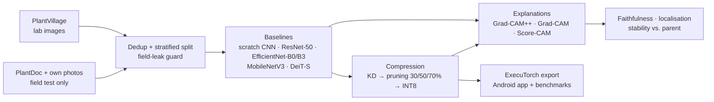

<div align="center">

# 🌿 crop-disease-xai

**Do compressed crop-disease models still explain themselves faithfully on a phone?**

Crop-leaf disease classification with **Grad-CAM++** explanations, a staged **compression** pipeline
(knowledge distillation → structured pruning → INT8) and **on-device** Android inference,
with a closed-form, gradient-free Grad-CAM++ that runs in a single forward pass.


</div>

---

## Contents
- [Overview](#overview)
- [Approach](#approach)
- [Results](#results)
- [Getting started](#getting-started)
- [Reproducibility](#reproducibility)
- [Repository layout](#repository-layout)
- [Project status & plan](#project-status--plan)
- [Datasets](#datasets)

## Overview

A farmer with a basic phone and patchy internet can't rely on a cloud model, and has no way to check
*why* an app says a leaf has late blight. Heatmap explanations can show the reasoning, but only if they
are **faithful**, and only if they survive the compression needed to run on cheap hardware.

This project measures that directly:

1. **Accuracy vs. size:** how much accuracy each compression stage costs (distillation, then pruning at 30/50/70%, then INT8).
2. **Explanation quality under compression:** whether Grad-CAM++ maps stay faithful and stable, and which compression stage changes them most.
3. **On-device cost:** whether Grad-CAM++ runs in real time on a mid-range Android phone (Pixel 6a).
4. **Lab → field gap:** models trained on clean lab images (PlantVillage) are evaluated on real field photos (PlantDoc), and the heatmaps show what the models rely on.

## Approach



### Gradient-free Grad-CAM++ on the device

Mobile runtimes only run forward passes, but Grad-CAM++ needs gradients. Every CNN here ends in
global average pooling followed by a single linear layer, so the gradient of class score $y_c$ with
respect to feature map $A^k$ (size $H \times W$) is a constant:

$$
g_k = \frac{\partial y_c}{\partial A^k_{ij}} = \frac{W_{ck}}{HW}
$$

Substituting into the Grad-CAM++ weights gives a closed form that needs only the feature maps and the classifier weights:

$$
\alpha_k = \frac{g_k^2}{2g_k^2 + g_k^3 \sum_{ij} A^k_{ij}}, \qquad
w_k = HW \cdot \mathrm{ReLU}(g_k)\,\alpha_k, \qquad
L_c = \mathrm{ReLU}\Big(\sum_k w_k A^k\Big)
$$

The exported model returns logits and the final feature maps, and the app computes the heatmap from
these in one pass. The implementation (`src/cropxai/explain/closed_form.py`) is tested to match
`pytorch-grad-cam` for every CNN in the study (`tests/test_explain.py`), so it is an exact
reformulation, not an approximation.

### Explanation metrics
- **Faithfulness:** deletion / insertion AUC, Average Drop, Increase in Confidence, ROAD (with a batched GPU implementation of ROAD's noisy linear imputation, tested against the reference implementation).
- **Localisation:** pointing game and IoU against hand-drawn lesion masks.
- **Stability under compression:** Spearman rank correlation, SSIM and top-10% IoU against the uncompressed parent's heatmaps.

## Results

> **Status:** baseline experiments are running. Every table below is generated by
> `scripts/make_tables.py` from `results/metrics/**.json`; cells stay empty (—) until the
> corresponding runs are finished and committed. Values are mean ± sample std over 3 seeds;
> `(n=k)` marks an incomplete seed set.

### Table 1 — Accuracy & efficiency
Field "strict" = argmax over all 38 classes (what the app does); "restricted" = argmax over the
classes present in the field set. Phone latency is added with the Android app.

<!-- table1:start -->
| Model | Params (M) | Size (MB) | Top-1 PV test (%) | Macro-F1 PV test (%) | ECE PV test | Field top-1 strict (%) | Field top-1 restricted (%) | Desktop GPU latency (ms) | Desktop CPU latency (ms) |
|---|---|---|---|---|---|---|---|---|---|
| — | — | — | — | — | — | — | — | — | — |
<!-- table1:end -->

### Table 2 — Explanation quality
The model's predicted class is explained on a fixed, seeded image sample (the same images for every
model). Pointing game and IoU need lesion masks, which exist only for the project's own field photos.

<!-- table2:start -->
| Model | Method | Del. AUC ↓ (test) | Ins. AUC ↑ (test) | Avg. Drop % ↓ (test) | Inc. Conf. % ↑ (test) | ROAD ↑ (test) | Del. AUC ↓ (field) | Ins. AUC ↑ (field) | Pointing ↑ (field) | IoU ↑ (field) |
|---|---|---|---|---|---|---|---|---|---|---|
| — | — | — | — | — | — | — | — | — | — | — |
<!-- table2:end -->

### Table 3 — Stability under compression (vs. uncompressed parent)
| Variant | Spearman ↑ | SSIM ↑ | Top-10% IoU ↑ |
|---|---|---|---|
| — | — | — | — |

### Table 4 — On-device (Pixel 6a)
| Variant | Disk (MB) | Cold start | Latency median | Latency p95 | Heatmap latency | Peak memory | Battery / N inf. |
|---|---|---|---|---|---|---|---|
| — | — | — | — | — | — | — | — |

## Getting started

### Install (local: tests and data tooling)
```bash
git clone https://github.com/ranjanvrma/crop-disease-xai.git
cd crop-disease-xai
python -m venv .venv
.venv/Scripts/python -m pip install -e ".[train,dev]"   # on Linux/macOS: .venv/bin/python
.venv/Scripts/python -m pytest
```
The unit tests use small synthetic images, so they run without the datasets.

### Data
Download PlantVillage (colour) and PlantDoc and lay them out as described in
[`data/README.md`](data/README.md). The train / val / test / field-test split is already pinned in
[`splits/`](splits/), so everyone uses the same split.

### Train and evaluate
Training runs on **Google Colab**: open [`notebooks/colab_bootstrap.ipynb`](notebooks/colab_bootstrap.ipynb)
and choose *Runtime → Run all*. It works through every experiment and seed in priority order, skips
finished work, and resumes after a disconnect.

Each step is also a plain script that takes a config plus optional `key=value` overrides:

```bash
python scripts/prepare_data.py       --config configs/experiment/prepare_data.yaml
python scripts/train.py              --config configs/experiment/effnet_b0_ft.yaml --seed 0
python scripts/evaluate.py           --config configs/experiment/effnet_b0_ft.yaml --seed 0
python scripts/verify_closed_form.py --config configs/experiment/effnet_b0_ft.yaml --seed 0
python scripts/explain.py            --config configs/experiment/effnet_b0_ft.yaml --seed 0
python scripts/make_tables.py
```

## Reproducibility
- **Config-driven:** one YAML per experiment in [`configs/experiment/`](configs/experiment/), composed from shared pieces via `inherits:`. No hyperparameters are hard-coded in scripts.
- **Three seeds** for every reported number, with seeded data loading and deterministic kernels where available.
- **Untouched field test set:** PlantDoc and own photos are never used for training or tuning. A guard (`src/cropxai/data/guard.py`) blocks them from training splits, including near-duplicate images (perceptual hashing), and only final evaluation may load them.
- **Pinned split:** the manifest in `splits/` records every image's relative path, label, split and hash.
- **Traceable numbers:** every result JSON stores the full config, git commit and library versions it came from. Runs are logged to Weights & Biases.
- **Safe re-runs:** finished training stores a fingerprint of its settings, so a seed is retrained only if its training settings change.

## Repository layout
```
configs/      base, data, model, train, explain and per-experiment YAMLs
src/cropxai/  data · models · train · explain · eval · compress · export · utils
scripts/      command-line entry points
splits/       pinned split manifest (paths, labels, image hashes)
notebooks/    Colab runner (generated by build_colab_notebook.py)
results/      metrics JSON (source of truth for all tables) and figures
research/     paper (LaTeX) and research notes
tests/        unit + end-to-end tests on synthetic data
```

## Project status & plan

*Last updated: 17 October 2026.*

| Phase | What | Status |
|---|---|---|
| 1 | Data pipeline and field-leak guard | ✅ Done |
| 2 | Models, training and evaluation code | ✅ Done |
| 3 | Explanations and explanation metrics | ✅ Done |
| — | Baseline experiments (10 models × 3 seeds) | 🟡 In progress: 7 / 30 seeds |
| 4 | Compression pipeline (KD → pruning → INT8) | ⬜ Not started |
| 5 | Core experiment: explanations under compression | ⬜ Not started |
| 6 | On-device closed-form Grad-CAM++ | 🟡 Method done and verified; export pending |
| 7 | ExecuTorch export, Android app, phone benchmarks | ⬜ Not started |
| 8 | Results dashboard, paper, release | ⬜ Not started |

### ✅ Done

**Phase 1: Data**
- [x] Loaders for PlantVillage (training), PlantDoc and own field photos (field test only), with optional lesion masks
- [x] PlantDoc → PlantVillage class mapping that fails loudly on any unmapped class
- [x] Perceptual-hash deduplication: exact duplicates removed; PlantVillage images that near-duplicate a field image are dropped
- [x] Stratified 80/10/10 split, pinned in `splits/` (43,424 train / 5,428 val / 5,428 test / 2,522 PlantDoc field test)
- [x] Field-leak guard, checked when the split is built and every time a loader is created

**Phase 2: Models, training, evaluation**
- [x] Scratch CNN, ResNet-50, EfficientNet-B0/B3, MobileNetV3 (head replaced by GAP + one linear layer), DeiT-S
- [x] Feature extraction (frozen backbone) and fine-tuning (lower learning rate for the backbone)
- [x] Evaluation: top-1, macro-F1, calibration (ECE), field accuracy (strict and restricted), size, desktop latency
- [x] Training that resumes after a disconnect, and skips seeds already finished with the current settings
- [x] Colab runner: one *Run all* works through the whole experiment queue

**Phase 3: Explanations**
- [x] Grad-CAM++, Grad-CAM and Score-CAM on the layer that feeds global average pooling
- [x] Faithfulness metrics (deletion/insertion AUC, Average Drop, Increase in Confidence, ROAD on the GPU) and localisation metrics (pointing game, IoU)
- [x] Closed-form, gradient-free Grad-CAM++, tested equal to the library version for every CNN and confirmed on trained checkpoints
- [x] Automatic README tables from the results files

### 🟡 In progress: baseline experiments

Queue order, chosen so the models that compression depends on finish first:

| Experiment | Purpose | Seeds done |
|---|---|---|
| `mnv3_fe`, `effnet_b0_fe` | lightweight students, frozen backbone | 3 / 3 each |
| `effnet_b0_ft`, `mnv3_ft` | **students for compression** | 0 / 3 |
| `effnet_b3_ft` | **teacher for distillation** | 0 / 3 |
| `scratch_cnn` | the baseline to beat | 1 / 3 |
| `resnet50_fe`, `resnet50_ft` | comparison rows | 0 / 3 |
| `deit_s_fe`, `deit_s_ft` | transformer comparison (first to cut if time runs short) | 0 / 3 |

Remaining work is roughly 15–20 GPU-hours. Current blocker: the free Colab GPU quota. Options are
to wait for it to reset, train on a local RTX 3050 laptop GPU, or buy Colab compute units.
Finished results so far are on Google Drive and still need to be committed to `results/metrics/`.

### ⬜ To do

**Phase 4: Compression** *(needs the fine-tuned students and the teacher)*
- [ ] Knowledge distillation: EfficientNet-B3 teacher → EfficientNet-B0 / MobileNetV3 students
- [ ] Structured pruning with Torch-Pruning at 30 / 50 / 70%, fine-tuning after each level, keeping the GAP + linear head
- [ ] INT8 post-training quantization (quantization-aware training only if accuracy drops too far)
- [ ] One config per method × level; this grid is the main results table

**Phase 5: Core experiment**
- [ ] Recompute faithfulness and localisation metrics at every compression level
- [ ] Stability against the uncompressed parent: Spearman, SSIM, top-10% IoU (Table 3)
- [ ] Centrepiece figure: accuracy vs. size and explanation quality vs. size on one plot
- [ ] Does compression make lab → field shortcut learning better or worse?

**Phase 6: On-device explanations**
- [ ] Export models with two outputs (logits + final feature maps) and ship the classifier weights with the app
- [ ] Reproduce the closed-form heatmap from the exported model and compare it with the desktop result

**Phase 7: Android app and benchmarks**
- [ ] ExecuTorch export (XNNPACK backend) in its own environment
- [ ] Kotlin + CameraX app: camera → label + confidence → heatmap overlay → "unsure" state below a confidence threshold tuned on validation data
- [ ] Pixel 6a (primary) and Galaxy Tab S9 FE+ benchmarks: size, cold start, latency median/p95, heatmap latency, peak memory, battery (Table 4)

**Phase 8: Release**
- [ ] Web results dashboard that reads `results/`
- [ ] Paper (intro, related work, method, setup, results, on-device, limitations) with tables generated from the results
- [ ] Trained weights and lesion annotations published; demo video; Android APK

### 📋 Needs to be done by hand
- [ ] Collect 150–300 own field leaf photos (classes PlantVillage covers), labels confirmed by a plant expert
- [ ] Draw lesion masks on 150–300 field images (CVAT or Label Studio); without them, pointing game and IoU stay empty
- [ ] Re-run the literature search before writing up (`research/notes/gap.md`): the research gap must be re-checked, not assumed
- [ ] Add a license to the repository

### Known limitations so far
- PlantDoc is web-scraped and contains some images that are not single leaves (e.g. fruit, whole fields). They are kept as-is: removing images after seeing results would amount to tuning on the test set.
- Feature-extraction runs use 6 epochs. This was chosen from the validation curve only.

## Datasets
| Dataset | Role | Source |
|---|---|---|
| PlantVillage (colour), 38 classes | training / validation / in-domain test | [spMohanty/PlantVillage-Dataset](https://github.com/spMohanty/PlantVillage-Dataset) |
| PlantDoc | field test only, mapped onto shared PlantVillage classes | [pratikkayal/PlantDoc-Dataset](https://github.com/pratikkayal/PlantDoc-Dataset) |
| Own field photos + lesion masks | field test only | collected for this project |

Please follow each dataset's own license and citation requirements.
