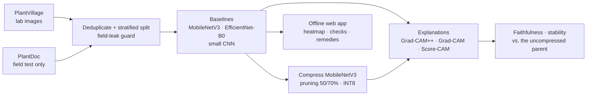

<div align="center">

# crop-disease-xai

**Do compressed crop-disease models still explain themselves faithfully on a phone?**

Crop-leaf disease classification with Grad-CAM++ explanations, a staged compression study
(structured pruning and INT8 quantization), and an offline web app that diagnoses a leaf and shows
its evidence on any phone or desktop, using a closed-form Grad-CAM++ that needs no gradients.

[](https://github.com/ranjanvrma/crop-disease-xai/actions/workflows/ci.yml)
[](LICENSE)


**[Live demo](https://crop-disease-xai.onrender.com/)** ·
[How it explains itself](https://crop-disease-xai.onrender.com/explain.html) ·
[Results](https://crop-disease-xai.onrender.com/results.html) ·
[Developer guide](docs/DEVELOPMENT.md)

</div>

---

## Contents

- [Highlights](#highlights)
- [Why this project](#why-this-project)
- [How it works](#how-it-works)
- [Results](#results)
- [Quick start](#quick-start)
- [Repository layout](#repository-layout)
- [Reproducibility](#reproducibility)
- [Roadmap](#roadmap)
- [Limitations](#limitations)
- [Contributing](#contributing)
- [Citation](#citation)
- [License and acknowledgements](#license-and-acknowledgements)

## Highlights

- **Explanations that run on the device.** Grad-CAM++ rewritten in closed form, so it needs only one
  forward pass. It matches `pytorch-grad-cam` to about 1e-6 and runs in the browser and on INT8 models.
- **A measured answer to the research question.** INT8 quantization keeps the heatmaps close to the
  original model's (Spearman 0.92); structured pruning changes them substantially (0.37–0.46).
- **An honest lab-to-field result.** About 97% accuracy on lab photos, but only 22–24% on real field
  photos, and the heatmaps help show why: the models lean on the plain lab background.
- **An offline web app for any phone.** It gives a diagnosis or says "not sure", shows a heatmap with
  a live faithfulness check, warns about photos that are not a supported crop, and offers remedies
  for all 38 classes. Photos never leave the device.
- **Reproducible by construction.** Every number comes from versioned result files, with three seeds,
  a pinned data split and a guard that keeps the field test set out of training.

## Why this project

A farmer with a basic phone and patchy internet can't rely on a cloud model, and has no way to check
*why* an app says a leaf has late blight. Heatmap explanations can show the reasoning, but only if they
are **faithful**, and only if they survive the compression needed to run on cheap hardware.

This project measures that directly:

1. **Accuracy vs. size:** what each compression stage costs (structured pruning at 50% and 70%,
   INT8 quantization, and both stacked).
2. **Explanation quality under compression:** whether Grad-CAM++ maps stay faithful and stable, and
   which compression stage changes them most.
3. **Lab-to-field gap:** models trained on clean lab images (PlantVillage) are tested on real field
   photos (PlantDoc), and the heatmaps show what the models rely on.
4. **On-device cost** (planned): Grad-CAM++ latency and memory on a mid-range Android phone.

The study is deliberately compute-lean: it compresses one mobile model (MobileNetV3) and compares it
with EfficientNet-B0 and a small CNN trained from scratch, so everything runs on a free-tier GPU.

## How it works



### Grad-CAM++ without gradients

Mobile and browser runtimes only run forward passes, but Grad-CAM++ needs gradients. Every network
here ends in global average pooling followed by a single linear layer, so the gradient of class score
$y_c$ with respect to feature map $A^k$ (size $H \times W$) is a constant:

$$
g_k = \frac{\partial y_c}{\partial A^k_{ij}} = \frac{W_{ck}}{HW}
$$

Substituting it into the Grad-CAM++ weights gives a closed form that needs only the feature maps and
the classifier weights:

$$
\alpha_k = \frac{g_k^2}{2g_k^2 + g_k^3 \sum_{ij} A^k_{ij}}, \qquad
w_k = HW \cdot \mathrm{ReLU}(g_k)\,\alpha_k, \qquad
L_c = \mathrm{ReLU}\Big(\sum_k w_k A^k\Big)
$$

The exported model returns its scores and its final feature maps, and the heatmap is computed from
them in the same pass. The Python implementation (`src/cropxai/explain/closed_form.py`) is tested
against `pytorch-grad-cam` for every network, and the browser version (`web/src/xai.js`) is tested
against the Python one, so it is an exact reformulation, not an approximation.

### Explanation metrics

- **Faithfulness:** deletion and insertion AUC, Average Drop, Increase in Confidence, and ROAD (with
  a batched GPU implementation of ROAD's noisy linear imputation, tested against the reference).
- **Localisation:** pointing game and IoU against lesion masks, once masks exist.
- **Stability under compression:** Spearman rank correlation, SSIM and top-10% IoU against the
  uncompressed parent's heatmaps.

## Results

The tables are generated by `scripts/make_tables.py` from `results/metrics/**.json`. Values are the
mean ± sample standard deviation over 3 seeds; `(n=1)` marks the single small-CNN run.

### Key findings

1. **Lab-to-field gap.** MobileNetV3 reaches 96.7% on PlantVillage test images but only 21.8% on
   PlantDoc field photos (EfficientNet-B0: 96.1% → 24.3%; small CNN: 99.8% → 15.4%, single run).
2. **Field-style augmentation barely helps.** Fully fine-tuning MobileNetV3 with blur, noise,
   shadows and other photo corruptions (`mnv3_ft_field`) lifts lab accuracy to 99.4% but field
   accuracy only from 21.8% to 23.4%.
3. **INT8 keeps the explanations; pruning does not.** INT8 costs 2.5 points of lab accuracy
   (96.7% → 94.1%) and its heatmaps stay close to the parent's (Spearman 0.92, SSIM 0.90). 50%
   structured pruning drops lab accuracy to 69.3% (88.9% after an 8-epoch fine-tune) and its heatmaps
   diverge strongly (Spearman 0.37–0.46); at 70% the field-set rank correlation is about zero.
4. **Grad-CAM was more faithful than Grad-CAM++** on the frozen-backbone models, on every
   faithfulness metric (e.g. deletion AUC 0.431 vs 0.476 for MobileNetV3), and about equal on the
   fully fine-tuned model.
5. **Closed-form Grad-CAM++ is exact:** it matches `pytorch-grad-cam` to about 1e-6 on every trained
   seed, which is what lets it run on INT8 models and in the browser.

> **Reading the pruned rows of Table 2:** their low deletion AUC does not mean better faithfulness.
> Pruned models are much less confident, so every probability curve starts lower; their insertion
> AUC, Average Drop and Increase in Confidence are all worse. Compare faithfulness only between models
> of similar accuracy, or use Table 3.

### Table 1: accuracy and efficiency

Field "strict" is the argmax over all 38 classes (what the app does); "restricted" is the argmax over
the classes present in the field set. Weights are parameters × 4 bytes (float) or × 1 byte (INT8).
Desktop latency is not reported for INT8 models, which run reference kernels on a desktop.

<!-- table1:start -->
| Model | Params (M) | Weights (MB) | Top-1 PV test (%) | Macro-F1 PV test (%) | ECE PV test | Field top-1 strict (%) | Field top-1 restricted (%) | Desktop GPU latency (ms) | Desktop CPU latency (ms) |
|---|---|---|---|---|---|---|---|---|---|
| effnet_b0_fe | 4.06 ± 0.00 | 16.22 ± 0.00 | 96.11 ± 0.27 | 95.07 ± 0.36 | 0.035 ± 0.000 | 24.27 ± 0.81 | 26.99 ± 1.07 | 5.61 ± 0.03 | 15.1 ± 1.8 |
| mnv3_fe | 3.01 ± 0.00 | 12.03 ± 0.00 | 96.66 ± 0.07 | 95.87 ± 0.12 | 0.052 ± 0.001 | 21.77 ± 0.14 | 24.56 ± 0.20 | 4.44 ± 0.06 | 9.4 ± 0.6 |
| mnv3_fe_int8 | 3.01 ± 0.00 | 3.01 ± 0.00 | 94.12 ± 0.04 | 92.82 ± 0.11 | 0.074 ± 0.000 | 21.28 ± 0.30 | 23.67 ± 0.41 | — | — |
| mnv3_fe_p50 | 0.79 ± 0.00 | 3.17 ± 0.00 | 69.25 ± 0.34 | 53.83 ± 0.28 | 0.056 ± 0.002 | 6.42 ± 0.26 | 8.55 ± 0.46 | 4.55 ± 0.08 | 6.9 ± 0.9 |
| mnv3_fe_p50_ft8 | 0.79 ± 0.00 | 3.17 ± 0.00 | 88.87 ± 0.45 | 84.44 ± 0.43 | 0.013 ± 0.001 | 9.90 ± 0.34 | 13.16 ± 0.22 | 7.52 ± 4.81 | 10.6 ± 1.4 |
| mnv3_fe_p50_int8 | 0.79 ± 0.00 | 0.79 ± 0.00 | 61.05 ± 2.05 | 44.53 ± 2.08 | 0.059 ± 0.032 | 6.05 ± 0.61 | 9.01 ± 0.42 | — | — |
| mnv3_fe_p70 | 0.30 ± 0.00 | 1.21 ± 0.00 | 51.62 ± 0.63 | 29.80 ± 0.49 | 0.085 ± 0.001 | 4.06 ± 0.75 | 6.16 ± 0.13 | 4.52 ± 0.11 | 5.2 ± 0.2 |
| mnv3_fe_p70_ft8 | 0.30 ± 0.00 | 1.21 ± 0.00 | 77.82 ± 0.51 | 66.47 ± 1.32 | 0.044 ± 0.002 | 5.74 ± 0.25 | 7.77 ± 0.08 | 4.65 ± 0.36 | 8.1 ± 2.4 |
| mnv3_fe_p70_int8 | 0.30 ± 0.00 | 0.30 ± 0.00 | 46.54 ± 0.14 | 26.37 ± 0.27 | 0.158 ± 0.027 | 3.13 ± 0.17 | 5.00 ± 0.60 | — | — |
| mnv3_ft_field | 3.01 ± 0.00 | 12.03 ± 0.00 | 99.44 ± 0.03 | 99.16 ± 0.05 | 0.105 ± 0.003 | 23.43 ± 0.56 | 27.44 ± 0.00 | 4.44 ± 0.11 | 12.4 ± 3.2 |
| scratch_cnn | 1.18 (n=1) | 4.73 (n=1) | 99.76 (n=1) | 99.66 (n=1) | 0.003 (n=1) | 15.42 (n=1) | 17.41 (n=1) | 0.80 (n=1) | 12.1 (n=1) |
<!-- table1:end -->

### Table 2: explanation quality

The predicted class is explained on a fixed, seeded image sample (the same images for every model).
Pointing game and IoU need lesion masks, which do not exist yet.

<!-- table2:start -->
| Model | Method | Del. AUC ↓ (test) | Ins. AUC ↑ (test) | Avg. Drop % ↓ (test) | Inc. Conf. % ↑ (test) | ROAD ↑ (test) | Del. AUC ↓ (field) | Ins. AUC ↑ (field) | Pointing ↑ (field) | IoU ↑ (field) |
|---|---|---|---|---|---|---|---|---|---|---|
| effnet_b0_fe | Grad-CAM++ | 0.533 ± 0.005 | 0.713 ± 0.008 | 43.0 ± 1.3 | 11.7 ± 0.9 | 0.108 ± 0.004 | 0.242 ± 0.013 | 0.418 ± 0.007 | — | — |
| effnet_b0_fe | Grad-CAM | 0.479 ± 0.005 | 0.749 ± 0.007 | 26.9 ± 1.2 | 24.9 ± 1.2 | 0.151 ± 0.004 | 0.176 ± 0.005 | 0.494 ± 0.018 | — | — |
| effnet_b0_fe | Score-CAM | 0.544 ± 0.015 | 0.704 ± 0.016 | 57.8 ± 4.2 | 5.3 ± 2.3 | 0.114 ± 0.012 | 0.207 ± 0.005 | 0.455 ± 0.012 | — | — |
| mnv3_fe | Grad-CAM++ | 0.476 ± 0.002 | 0.733 ± 0.002 | 37.0 ± 0.2 | 12.8 ± 0.2 | 0.117 ± 0.001 | 0.226 ± 0.001 | 0.474 ± 0.001 | — | — |
| mnv3_fe | Grad-CAM | 0.431 ± 0.001 | 0.754 ± 0.003 | 36.9 ± 0.2 | 21.3 ± 0.6 | 0.144 ± 0.003 | 0.183 ± 0.002 | 0.534 ± 0.003 | — | — |
| mnv3_fe | Score-CAM | 0.496 ± 0.005 | 0.686 ± 0.003 | 48.8 ± 0.1 | 12.0 ± 0.0 | 0.085 ± 0.002 | 0.217 ± 0.002 | 0.498 ± 0.006 | — | — |
| mnv3_fe_int8 | Grad-CAM++ (closed form) | 0.376 ± 0.001 | 0.629 ± 0.002 | 55.0 ± 0.2 | 10.6 ± 0.5 | 0.111 ± 0.002 | 0.233 ± 0.003 | 0.468 ± 0.005 | — | — |
| mnv3_fe_p50 | Grad-CAM++ | 0.131 ± 0.005 | 0.261 ± 0.008 | 85.8 ± 2.1 | 5.2 ± 1.2 | 0.095 ± 0.004 | 0.115 ± 0.005 | 0.252 ± 0.012 | — | — |
| mnv3_fe_p50_ft8 | Grad-CAM++ | 0.203 ± 0.007 | 0.421 ± 0.017 | 84.4 ± 2.9 | 2.7 ± 0.9 | 0.144 ± 0.003 | 0.162 ± 0.014 | 0.379 ± 0.012 | — | — |
| mnv3_fe_p50_int8 | Grad-CAM++ (closed form) | 0.115 ± 0.004 | 0.276 ± 0.002 | 84.8 ± 1.4 | 7.6 ± 1.6 | 0.105 ± 0.004 | 0.106 ± 0.014 | 0.297 ± 0.023 | — | — |
| mnv3_fe_p70 | Grad-CAM++ | 0.104 ± 0.003 | 0.304 ± 0.005 | 94.0 ± 2.1 | 1.4 ± 0.2 | 0.084 ± 0.003 | 0.082 ± 0.011 | 0.243 ± 0.033 | — | — |
| mnv3_fe_p70_ft8 | Grad-CAM++ | 0.130 ± 0.008 | 0.470 ± 0.006 | 90.7 ± 4.0 | 3.0 ± 0.7 | 0.119 ± 0.007 | 0.131 ± 0.013 | 0.321 ± 0.048 | — | — |
| mnv3_fe_p70_int8 | Grad-CAM++ (closed form) | 0.106 ± 0.035 | 0.228 ± 0.010 | 84.7 ± 1.6 | 6.0 ± 2.2 | 0.063 ± 0.011 | 0.083 ± 0.010 | 0.222 ± 0.044 | — | — |
| mnv3_ft_field | Grad-CAM++ | 0.345 ± 0.012 | 0.818 ± 0.005 | 29.3 ± 1.4 | 16.6 ± 2.6 | 0.201 ± 0.002 | 0.127 ± 0.007 | 0.423 ± 0.007 | — | — |
| mnv3_ft_field | Grad-CAM | 0.341 ± 0.012 | 0.824 ± 0.006 | 29.4 ± 2.0 | 16.4 ± 2.8 | 0.212 ± 0.001 | 0.107 ± 0.006 | 0.486 ± 0.012 | — | — |
| mnv3_ft_field | Score-CAM | 0.370 ± 0.009 | 0.817 ± 0.012 | 48.5 ± 0.8 | 8.7 ± 1.2 | 0.195 ± 0.010 | 0.149 ± 0.014 | 0.439 ± 0.005 | — | — |
| scratch_cnn | Grad-CAM++ | 0.289 (n=1) | 0.909 (n=1) | 34.8 (n=1) | 4.7 (n=1) | 0.238 (n=1) | 0.191 (n=1) | 0.631 (n=1) | — | — |
| scratch_cnn | Grad-CAM | 0.280 (n=1) | 0.910 (n=1) | 43.9 (n=1) | 4.7 (n=1) | 0.229 (n=1) | 0.177 (n=1) | 0.643 (n=1) | — | — |
| scratch_cnn | Score-CAM | 0.289 (n=1) | 0.896 (n=1) | 29.0 (n=1) | 2.0 (n=1) | 0.189 (n=1) | 0.230 (n=1) | 0.591 (n=1) | — | — |
<!-- table2:end -->

### Table 3: stability under compression

Closed-form Grad-CAM++ maps of each compressed variant compared with the uncompressed parent's, for
the class the parent predicts, on the same images.

<!-- table3:start -->
| Variant | Spearman ↑ (test) | SSIM ↑ (test) | Top-10% IoU ↑ (test) | Spearman ↑ (field) | SSIM ↑ (field) | Top-10% IoU ↑ (field) |
|---|---|---|---|---|---|---|
| mnv3_fe_int8 | 0.919 ± 0.000 | 0.903 ± 0.000 | 0.638 ± 0.001 | 0.927 ± 0.001 | 0.899 ± 0.001 | 0.672 ± 0.003 |
| mnv3_fe_p50 | 0.368 ± 0.005 | 0.529 ± 0.003 | 0.125 ± 0.003 | 0.137 ± 0.007 | 0.471 ± 0.006 | 0.111 ± 0.007 |
| mnv3_fe_p50_ft8 | 0.462 ± 0.009 | 0.544 ± 0.006 | 0.151 ± 0.005 | 0.308 ± 0.007 | 0.524 ± 0.002 | 0.154 ± 0.002 |
| mnv3_fe_p50_int8 | 0.370 ± 0.012 | 0.530 ± 0.007 | 0.129 ± 0.005 | 0.251 ± 0.016 | 0.502 ± 0.005 | 0.131 ± 0.004 |
| mnv3_fe_p70 | 0.240 ± 0.008 | 0.436 ± 0.004 | 0.109 ± 0.002 | 0.002 ± 0.017 | 0.410 ± 0.006 | 0.062 ± 0.003 |
| mnv3_fe_p70_ft8 | 0.398 ± 0.015 | 0.477 ± 0.005 | 0.152 ± 0.005 | 0.133 ± 0.002 | 0.463 ± 0.005 | 0.114 ± 0.003 |
| mnv3_fe_p70_int8 | 0.209 ± 0.014 | 0.407 ± 0.009 | 0.103 ± 0.003 | -0.021 ± 0.009 | 0.395 ± 0.008 | 0.057 ± 0.005 |
<!-- table3:end -->

## Quick start

### Try it

Open **[crop-disease-xai.onrender.com](https://crop-disease-xai.onrender.com/)** and photograph a
leaf, choose an image, or try a sample. It works offline after the first visit and can be installed
as an app.

### Run the web app locally

The trained model bundles are committed in `web/public/models/`, so no training is needed.

```bash
git clone https://github.com/ranjanvrma/crop-disease-xai.git
cd crop-disease-xai/web
npm ci
npm run dev          # http://localhost:5173
npm run build        # static site in web/dist/, deployable to any static host
```

See [`web/README.md`](web/README.md) for how the app is built, tested and deployed.

### Set up the Python pipeline

```bash
python -m venv .venv
.venv/bin/python -m pip install -e ".[train,compress,dev,web]"   # Windows: .venv\Scripts\python
.venv/bin/python -m pytest -q
```

The unit tests use small synthetic images, so they run without the datasets.

### Data

Download PlantVillage (colour) and PlantDoc and lay them out as described in
[`data/README.md`](data/README.md). The train / validation / test / field-test split is pinned in
[`splits/`](splits/), so everyone uses the same images.

### Train and evaluate

Training runs on Google Colab: open [`notebooks/colab_bootstrap.ipynb`](notebooks/colab_bootstrap.ipynb)
and choose *Runtime → Run all*. It works through every experiment and seed in priority order, skips
finished work, and resumes after a disconnect. Each step is also a plain script that takes a config
plus optional `key=value` overrides:

```bash
python scripts/prepare_data.py       --config configs/experiment/prepare_data.yaml
python scripts/train.py              --config configs/experiment/mnv3_fe_p50.yaml --seed 0
python scripts/evaluate.py           --config configs/experiment/mnv3_fe_p50.yaml --seed 0
python scripts/verify_closed_form.py --config configs/experiment/mnv3_fe_p50.yaml --seed 0
python scripts/explain.py            --config configs/experiment/mnv3_fe_p50.yaml --seed 0
python scripts/make_tables.py
python scripts/export_web.py         --config configs/experiment/mnv3_ft_field.yaml --seed 0 --out web/public/models/mnv3_ft_field
```

## Repository layout

```
configs/      shared YAML pieces and one file per experiment
src/cropxai/  data · models · train · explain · eval · compress · export · utils
scripts/      command-line entry points
knowledge/    remedies for all 38 classes
web/          offline web app and demo site (Vite, ONNX Runtime Web)
splits/       pinned split manifest (paths, labels, image hashes)
notebooks/    Colab runner (generated by build_colab_notebook.py)
results/      metrics JSON (source of truth for every table) and generated tables
docs/         developer guide and research notes
tests/        unit and end-to-end tests on synthetic data
```

## Reproducibility

- **Config-driven:** one YAML per experiment in [`configs/experiment/`](configs/experiment/), composed
  from shared pieces with `inherits:`. No hyperparameters are hard-coded in scripts.
- **Three seeds** for every reported number, with seeded data loading and deterministic kernels where
  available.
- **Untouched field test set:** PlantDoc is never used for training or tuning. A guard
  (`src/cropxai/data/guard.py`) blocks it from training splits, including near-duplicates found by
  perceptual hashing.
- **Pinned split:** `splits/` records every image's relative path, label, split and hash.
- **Traceable numbers:** every result JSON stores the full config, git commit and library versions.
- **Safe re-runs:** finished training stores a fingerprint of its settings, so a seed is retrained only
  when its training settings change.

## Roadmap

| Area | Status |
|---|---|
| Data pipeline, deduplication, pinned split, field-leak guard | Done |
| Baselines (MobileNetV3, EfficientNet-B0, small CNN), training with resume, evaluation | Done |
| Grad-CAM++, Grad-CAM, Score-CAM, faithfulness metrics, closed-form Grad-CAM++ | Done |
| Compression of MobileNetV3: pruning 50/70% (with and without fine-tuning) and INT8, 7 variants × 3 seeds | Done |
| Explanation quality and stability under compression (Tables 2–3) | Metrics done; summary figure and write-up in progress |
| Field-robust model `mnv3_ft_field` | Done |
| Offline web app and demo site with 4 models and remedies for all 38 classes | [Live](https://crop-disease-xai.onrender.com/); remedies await expert review |
| On-device benchmarks on a Pixel 6a (ExecuTorch export) | Planned |
| Paper, released weights and lesion annotations | Planned |

Help is welcome on all of these; see [CONTRIBUTING.md](CONTRIBUTING.md). Open tasks that need a
person rather than code: collecting labelled field photos with lesion masks, re-running the literature
search ([`docs/research-gap.md`](docs/research-gap.md)), and an expert review of
[`knowledge/remedies.yaml`](knowledge/remedies.yaml).

## Limitations

- Compression is studied on one architecture (MobileNetV3) whose parent was trained with a frozen
  backbone. Uniform structured pruning of such a parent loses a lot of accuracy; other architectures
  and fully fine-tuned parents are future work.
- There is no knowledge-distillation stage: the study covers pruning and quantization only.
- The small CNN is a single run, not a 3-seed result.
- PlantDoc is web-scraped and contains some images that are not single leaves. They are kept as-is,
  because removing images after seeing results would amount to tuning on the test set.
- All committed results come from one machine (an RTX 5070 Ti laptop GPU; the versions are recorded
  in every result file).
- The web app is a research prototype, not a certified diagnostic tool, and its remedies have not
  been reviewed by a plant pathologist.

## Contributing

Contributions are welcome: bug reports, fixes, app improvements, remedy reviews and new experiments.
Please read [CONTRIBUTING.md](CONTRIBUTING.md) first; it covers the setup and the research rules that
keep the results trustworthy. To report a security problem, see [SECURITY.md](SECURITY.md).

## Citation

If you use this code or its results, please cite it. GitHub's *Cite this repository* button uses
[`CITATION.cff`](CITATION.cff):

```bibtex
@software{crop_disease_xai,
  author  = {Verma, Ranjan and Narkhede, Rahul},
  title   = {crop-disease-xai: Grad-CAM++ explanations for compressed crop-disease models, on the device},
  year    = {2026},
  url     = {https://github.com/ranjanvrma/crop-disease-xai},
  license = {MIT}
}
```

## License and acknowledgements

The code is released under the [MIT License](LICENSE). The datasets are **not** covered by it; follow
each dataset's own licence and citation requirements.

| Dataset | Role | Source |
|---|---|---|
| PlantVillage (colour), 38 classes | training, validation, lab test | [spMohanty/PlantVillage-Dataset](https://github.com/spMohanty/PlantVillage-Dataset) |
| PlantDoc | field test only, mapped onto the shared PlantVillage classes | [pratikkayal/PlantDoc-Dataset](https://github.com/pratikkayal/PlantDoc-Dataset) |

Built with [PyTorch](https://pytorch.org/), [timm](https://github.com/huggingface/pytorch-image-models),
[pytorch-grad-cam](https://github.com/jacobgil/pytorch-grad-cam),
[Torch-Pruning](https://github.com/VainF/Torch-Pruning), [ONNX Runtime Web](https://onnxruntime.ai/),
[Vite](https://vite.dev/), [Motion](https://motion.dev/) and [Lucide](https://lucide.dev/) icons.
